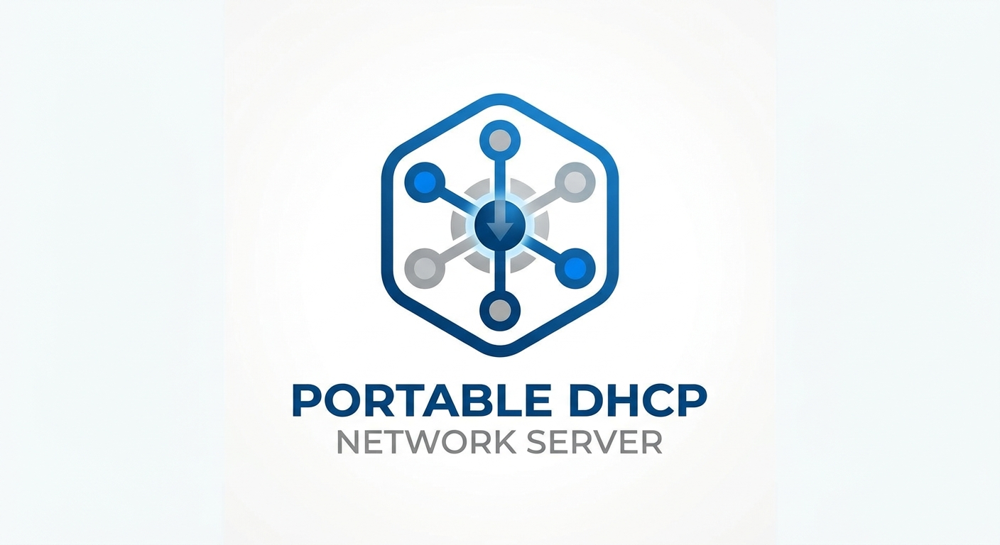

<div align="center">

# 🚀 Portable DHCP Server for Windows

**Ein ultraleichter, portabler und blitzschneller DHCP-Server in einer einzigen C#-Datei.**



[](LICENSE)
[](https://www.microsoft.com/windows)
[](https://dotnet.microsoft.com/)

[Features](#-features) • [Schnellstart](#-schnellstart) • [Build-Anleitung](#-build-anleitung-ohne-visual-studio) • [Sicherheitskonzept](#-sicherheits--restore-konzept)

</div>

---

## 📌 Übersicht

Dieser **Portable DHCP Server** ist das ideale Werkzeug für Systemadministratoren, Techniker und Entwickler. Er erfordert keine Installation, keine externen Abhängigkeiten und lässt sich auf jedem Windows-System innerhalb von Sekunden starten oder direkt aus dem Quellcode kompilieren.

Egal ob für **Notfall-Netzwerke**, **Isolated-Lab-Umgebungen**, **LAN-Parties** oder die **Direktverbindung zu Netzwerkgeräten** (z. B. IP-Kameras, Switche, Router) – dieses Tool übernimmt die IP-Vergabe zuverlässig und ohne Ballast.

---

## ✨ Features

- ⚡ **100% Portabel & Standalone:** Läuft direkt als einzelne `.exe` ohne Installation oder externe DLLs.
- 📜 **Echtzeit-Logging:** Detailliertes Protokoll aller DHCP-Anfragen (`DISCOVER`, `OFFER`, `REQUEST`, `ACK`, `RELEASE`, `DECLINE`) inkl. MAC-Adressen und Hostnamen.
- 🛡️ **Automatisches Backup & Recovery:** Speichert die ursprüngliche Netzwerkkonfiguration der gewählten Schnittstelle und stellt diese beim Stoppen oder nach einem unerwarteten Systemabsturz automatisch wieder her.
- 🔧 **Zero-Setup-Compiling:** Kann mit dem in Windows integrierten `.NET`-Compiler ohne Visual Studio kompiliert werden.
- 🌐 **Flexibler IP-Pool:** Automatische Berechnung von Server-IP, Subnetzmaske, Gateway und DNS-Servern basierend auf den Benutzereingaben.
- 🔌 **Link-Awareness:** Erkennt automatisch Kabeltrennugen oder Statusänderungen der Netzwerkkarte.

---

## 🚀 Schnellstart

1. Lade die neueste `DhcpServer.exe` aus den **[Releases](../../releases)** herunter.
2. Starte die Anwendung als **Administrator** *(automatische Rechteanforderung integriert)*.
3. Wähle die gewünschte **Netzwerkschnittstelle** aus.
4. Trage die **Netzadresse** (z. B. `192.168.100.0`), **Subnetzmaske** sowie optional **Gateway** und **DNS** ein.
5. Klicke auf **Starten** – fertig!

---

## 🛠️ Build-Anleitung (Ohne Visual Studio)

Da das gesamte Projekt in einer einzigen Datei (`DhcpServer.cs`) strukturiert ist, benötigst du kein installiertes Visual Studio. Der Standard-C#-Compiler von Windows (`csc.exe`) reicht völlig aus.

### Schritt-für-Schritt-Kompilierung:

1. Öffne die **Eingabeaufforderung (cmd.exe)** im Verzeichnis der `DhcpServer.cs`.
2. Führe folgenden Befehl aus:

```cmd
%WINDIR%\Microsoft.NET\Framework64\v4.0.30319\csc.exe /nologo /codepage:65001 /target:winexe /optimize+ /r:System.Windows.Forms.dll /r:System.Drawing.dll /out:DhcpServer.exe DhcpServer.cs
```

3. Die erstelle `DhcpServer.exe` ist sofort einsatzbereit.

---

## 🛡️ Sicherheits- & Restore-Konzept

Bei der Aktivierung setzt der Server die gewählte Netzwerkschnittstelle auf eine statische IP-Adresse. Um Änderungen am System zu vermeiden:

1. Vor jeder Änderung wird die aktuelle IP-, DHCP- und DNS-Konfiguration ausgelesen und in einer `.restore`-Datei gesichert.
2. Beim regulären Beenden der Anwendung werden alle Schnittstellen-Parameter exakt auf den Ursprungszustand zurückgesetzt.
3. Sollte das Programm hart beendet werden (z. B. Stromausfall, Task-Manager), erkennt die Anwendung beim nächsten Start das unvollständige Beenden und bietet eine sofortige Wiederherstellung an.

---

## 📝 Lizenz

Dieses Projekt ist unter der **MIT-Lizenz** veröffentlich – freie Nutzung, Änderung und Weitergabe erlaubt.